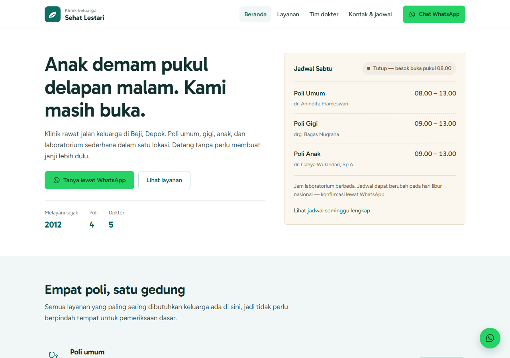
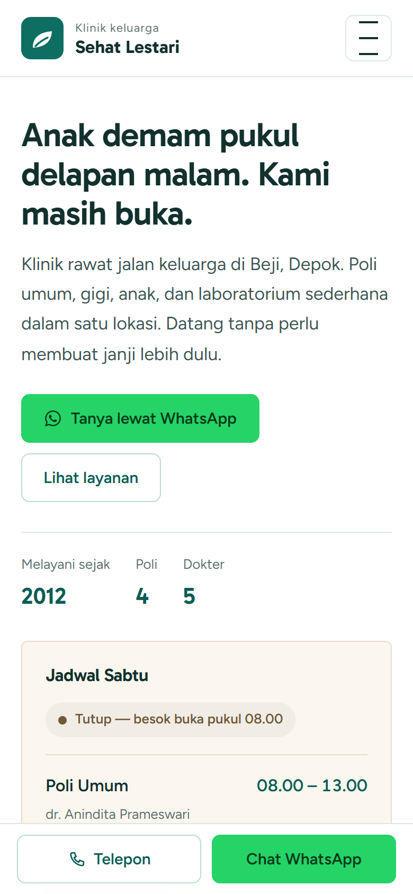
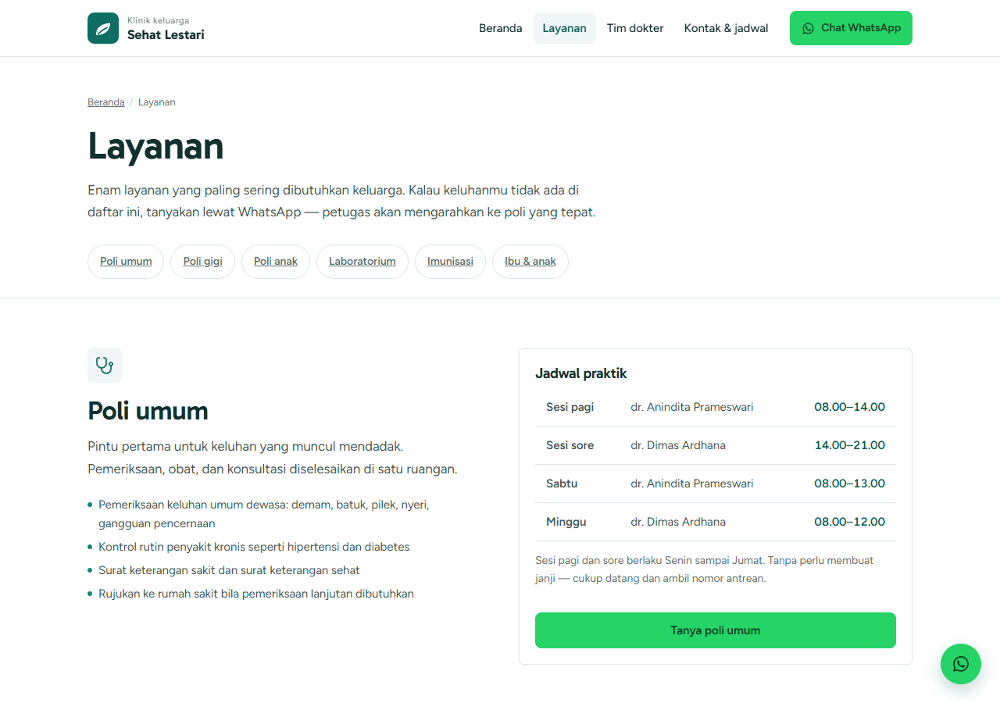
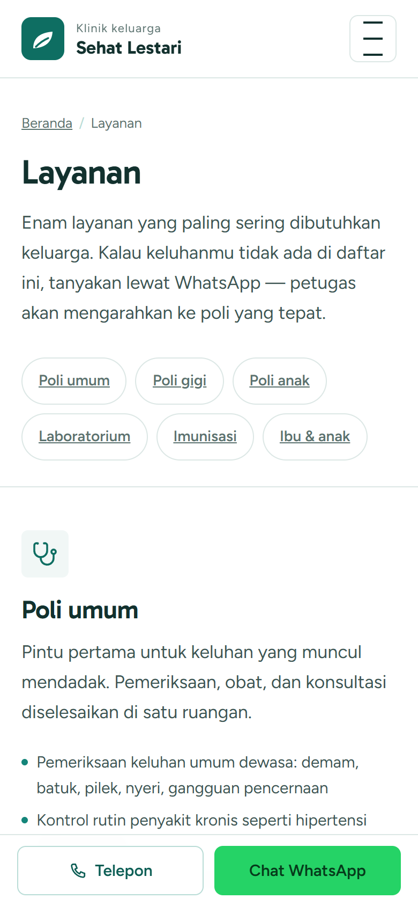
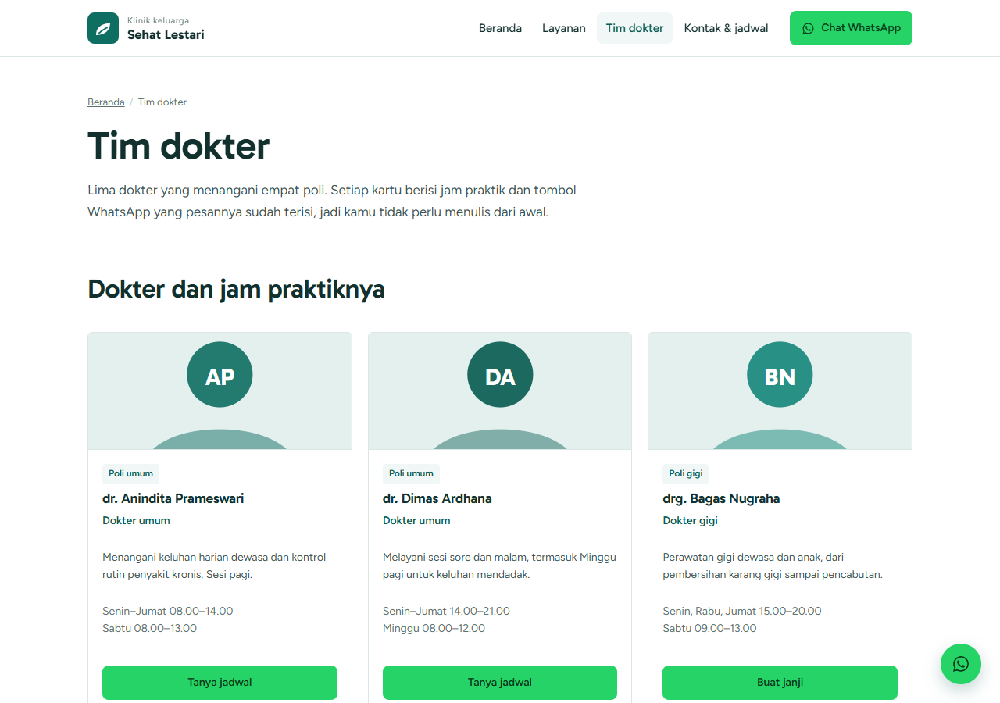
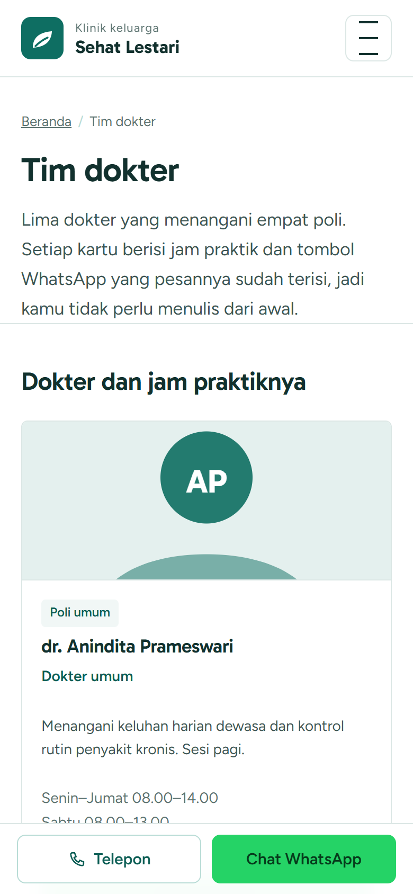
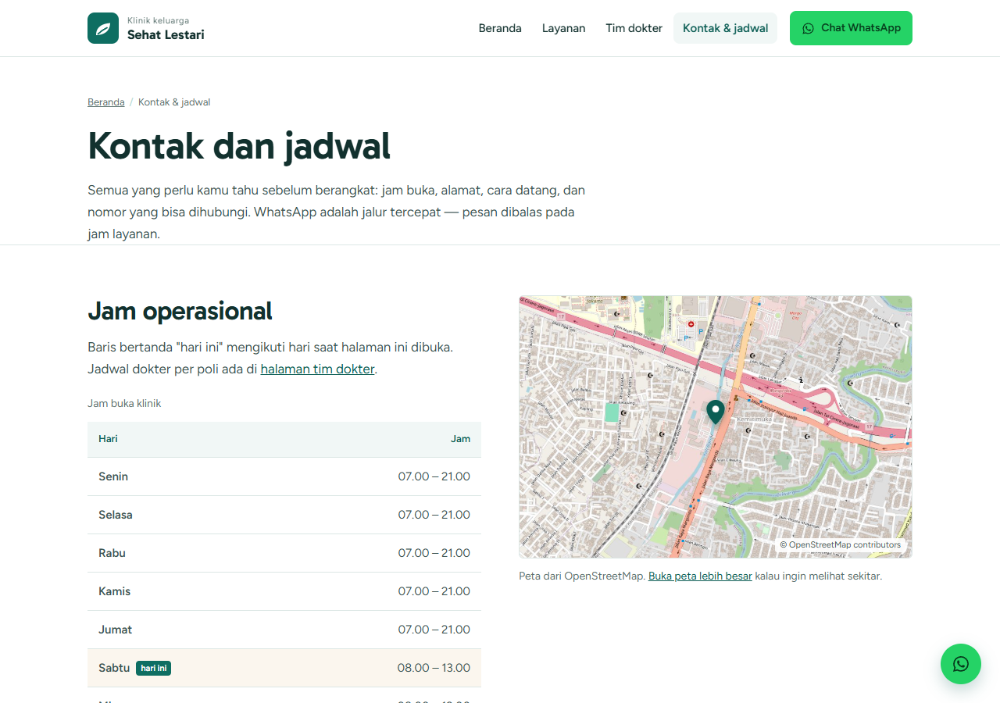
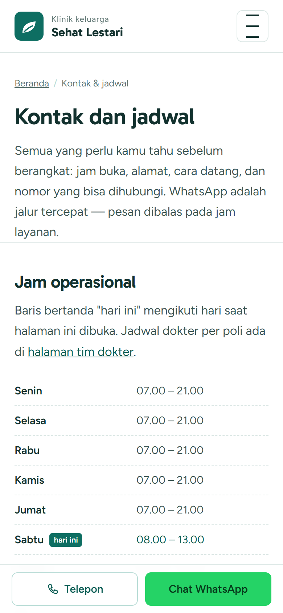
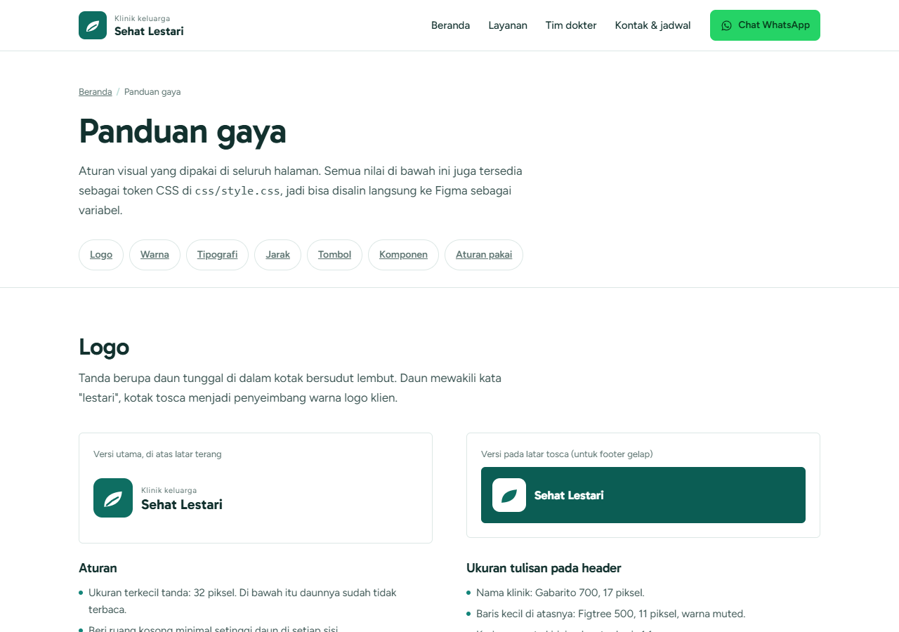
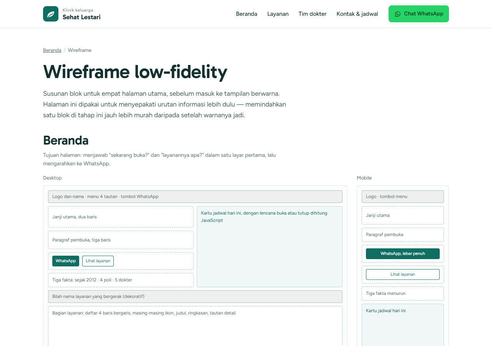

# Klinik Sehat Lestari — Website Company Profile

Mockup website untuk klinik keluarga fiktif di Beji, Depok. Dibuat sebagai studi kasus portofolio front-end: empat halaman yang menjawab pertanyaan yang paling sering masuk ke WhatsApp klinik — layanan apa, dokter siapa, buka jam berapa, di mana, dan bagaimana menghubungi.

> **Data demo.** Klinik, dokter, jadwal, alamat, nomor telepon, dan peta adalah fiktif. Website ini bukan layanan kesehatan sungguhan.

**Status:** selesai dan live di Netlify. Tidak ada backend, form booking, atau data pasien.

**Live demo:** <https://klinik-sehat-lestari.netlify.app>

## Masalah yang diselesaikan

Informasi klinik kecil biasanya tersebar di story WhatsApp, Instagram, atau poster di depan pintu. Jadwal dokter berubah, pasien harus bertanya satu per satu, dan pertanyaan yang sama dijawab berulang oleh petugas.

Target penggunanya orang tua usia 25–45 yang membuka website dari HP, sering dalam situasi tidak sabar: anak demam, butuh tahu apakah klinik masih buka, atau ingin memastikan dokter yang dituju sedang praktik.

Karena itu halaman beranda langsung menjawab tiga hal: **buka atau tutup**, **layanan apa saja**, dan **tombol WhatsApp**. Bukan company profile yang penuh animasi tapi lambat dijawab.

## Halaman

| Halaman | Isi |
| --- | --- |
| `index.html` | Hero, status buka dan jadwal hari ini, empat poli, alasan datang, dokter minggu ini, lokasi + peta, CTA WhatsApp |
| `layanan.html` | Enam layanan, jam praktik per poli, langkah berobat, tombol WhatsApp sesuai konteks layanan |
| `tim-dokter.html` | Lima profil dokter, jadwal per poli dalam akordeon di mobile, tombol WhatsApp per dokter |
| `kontak.html` | Jam operasional, alamat, peta, cara datang, telepon, WhatsApp |
| `style-guide.html` | Token warna, tipografi, komponen, aturan kontras, dan checklist aksesibilitas |
| `wireframe.html` | Wireframe low-fidelity empat halaman untuk desktop dan mobile |

## Fitur

- Layout responsif; diuji pada lebar 390 px, 768 px, dan 1280 px.
- WhatsApp selalu terlihat: action bar sticky di mobile (Telepon + WhatsApp) dan floating button di desktop.
- Pesan WhatsApp sudah terisi otomatis sesuai konteks: jadwal dokter, poli, atau pertanyaan umum.
- Status buka/tutup dan jadwal hari ini dihitung dari satu sumber data di JavaScript.
- Peta statis dari tile OpenStreetMap (182 KB), dengan penanda dan tautan ke peta penuh. Tidak memakai iframe yang berat atau bergantung pada consent Google Maps.
- Navigasi mobile dengan drawer, tombol Escape untuk menutup, dan fokus kembali ke tombol menu.
- Akordeon jadwal per poli di mobile; di desktop jadwal tampil sebagai tabel.
- Skip link, fokus yang terlihat, target sentuh minimal 44 px, dan dukungan `prefers-reduced-motion`.
- Fallback tanpa JavaScript: status yang bergantung pada JS disembunyikan, diganti tautan ke jadwal mingguan.
- Tanpa framework, tanpa build step, dan tanpa dependency JavaScript.

## Tech stack

- HTML5 semantik
- CSS custom properties (satu file, tanpa framework)
- Vanilla JavaScript (~8 KB, tanpa dependency)
- Google Fonts: Gabarito (judul) dan Figtree (isi)
- Peta statis dari tile OpenStreetMap, atribusi ditampilkan di gambar

## Struktur

```text
.
├── index.html
├── layanan.html
├── tim-dokter.html
├── kontak.html
├── style-guide.html
├── wireframe.html
├── robots.txt
├── css/
│   └── style.css
├── js/
│   └── main.js
├── assets/
│   └── peta-lokasi.jpg
├── docs/
│   ├── design-notes.md
│   └── screenshots/
└── README.md
```

## Menjalankan secara lokal

Tidak ada proses build. Cukup jalankan static server dari folder project:

```bash
python -m http.server 8000
```

Atau:

```bash
npx serve .
```

Lalu buka `http://localhost:8000`.

Membuka `index.html` langsung dari file manager juga bisa, tetapi static server lebih mendekati kondisi produksi.

## Deployment

Demo produksi: <https://klinik-sehat-lestari.netlify.app> — Netlify, HTTPS otomatis, tanpa build step.

Kalau perlu deploy ulang, buat folder publish bersih supaya `.git/` dan screenshot untuk QA di `docs/` tidak ikut terunggah:

```bash
mkdir -p dist
cp *.html robots.txt dist/
cp -r css js assets dist/
netlify deploy --prod --dir=dist --site 480539a3-9751-458d-a248-89515d98fba3
```

`dist/` sudah masuk `.gitignore`.

## Data demo

| Data | Nilai |
| --- | --- |
| Alamat | Jl. Margonda Raya No. 214, Kemiri Muka, Beji, Depok 16423 |
| Telepon | (021) 1234 5678 |
| WhatsApp | 0812-3456-7890 (`wa.me/6281234567890`) |
| Senin–Jumat | 07.00–21.00 |
| Sabtu | 08.00–13.00 |
| Minggu | 08.00–12.00 |
| Koordinat peta | `-6.3787, 106.8309` |

Lima dokter demo:

| Dokter | Poli | Jadwal |
| --- | --- | --- |
| dr. Anindita Prameswari | Umum | Senin–Jumat 08.00–14.00, Sabtu 08.00–13.00 |
| dr. Dimas Ardhana | Umum | Senin–Jumat 14.00–21.00, Minggu 08.00–12.00 |
| drg. Bagas Nugraha | Gigi | Senin, Rabu, Jumat 15.00–20.00, Sabtu 09.00–13.00 |
| dr. Cahya Wulandari, Sp.A | Anak | Selasa & Kamis 16.00–20.00, Sabtu 09.00–13.00 |
| dr. Endah Kusumastuti, Sp.PK | Laboratorium | Senin–Jumat 07.00–12.00 |

Kalau data ini dipakai untuk klinik sungguhan, ganti nama, nomor, alamat, koordinat, dan jadwal terlebih dahulu. Konstanta `NOMOR_WA_DEMO` di `js/main.js` juga perlu disesuaikan supaya dialog demo tidak lagi muncul untuk nomor baru.

## Keputusan desain

**Arah visual.** Halaman disusun seperti meja pendaftaran: rata kiri, garis rambut sebagai pemisah, banyak ruang kosong, dan satu kartu jadwal yang menonjol. Saya sengaja menghindari tumpukan kartu bundar dan gradient yang membuat website klinik terasa seperti template.

**Warna.** Tosca `#0E6E62` mengikuti logo, dipadukan dengan putih, tint tosca, dan krem hangat. Hijau WhatsApp `#25D366` hanya dipakai untuk aksi WhatsApp supaya tidak berebut perhatian dengan warna brand. Semua pasangan teks utama lolos WCAG AA; angkanya ada di `style-guide.html`.

**Tipografi.** Gabarito untuk judul karena bentuknya ramah dan tegas; Figtree untuk isi karena nyaman dibaca di layar kecil. Keduanya bukan pilihan default Inter/Poppins yang sering muncul di template.

**WhatsApp sebagai jalur utama.** Klinik kecil biasanya memang bekerja lewat WhatsApp. Karena itu tombolnya selalu tersedia, tetapi tetap ada alternatif Telepon dan halaman kontak. Pesan otomatis mengurangi langkah “Halo, mau tanya…” yang tidak perlu.

**Peta statis.** Google Maps embed tidak stabil di lingkungan screenshot dan membutuhkan consent; iframe OpenStreetMap juga lambat memuat tile. Saya pakai potongan tile OpenStreetMap sebagai gambar statis, beri atribusi, dan tautkan ke peta penuh. Hasilnya cepat, deterministik, dan tetap bisa diklik.

**Aksesibilitas.** Struktur memakai landmark, heading berurutan, skip link, `aria-current`, `aria-expanded`, dan label yang jelas. Target sentuh minimal 44 px. Animasi dimatikan saat `prefers-reduced-motion: reduce`. Kartu status memakai `aria-live="polite"` supaya perubahan status tidak mengagetkan pembaca layar.

Alasan yang lebih panjang, termasuk trade-off dan bahan interview, ada di [`docs/design-notes.md`](docs/design-notes.md).

## QA

Diuji dengan Chrome desktop 1280 px dan mobile 390 px (headless Chrome via CDP, ditambah pengecekan manual di browser).

- 0 console error dan 0 request gagal di enam halaman.
- Tidak ada horizontal overflow pada 1280 px dan 390 px.
- Semua tautan internal dan anchor valid; gambar peta termuat (960 × 640).
- Target sentuh minimum 44 px di mobile.
- Drawer mobile: buka, tutup lewat Escape, dan fokus kembali ke tombol menu.
- Akordeon jadwal: toggle buka/tutup berfungsi.
- `prefers-reduced-motion`: transisi dan animasi menjadi ~0 detik.
- Tanpa JavaScript: navigasi dan jadwal mingguan tetap terbaca; kartu status diganti fallback.
- Kontras teks: ink 13,96:1, body 7,90:1, muted 5,07:1, tosca-600 6,13:1, tosca-700 7,75:1, WhatsApp 6,50:1.
- Lighthouse (Chrome) di enam halaman: Accessibility 100, Best Practices 100, SEO 100. Kategori Performance tidak tersedia di runner yang dipakai, jadi belum ada skor performa.
- Live Netlify: tujuh halaman balas 200, CSS/JS/peta termuat, dan dialog demo WhatsApp berfungsi.

Belum diuji:

- Safari, Firefox, dan perangkat fisik.
- Screen reader sungguhan (NVDA/VoiceOver).
- Belum ada automated test suite; pengecekan di atas dilakukan lewat skrip QA sementara dan inspeksi visual.

## Screenshot

Preview viewport (desktop 1280 × 900, mobile 390 × 844). Screenshot full-page tersedia lewat tautan di bawah tabel.

| Halaman | Desktop | Mobile |
| --- | --- | --- |
| Beranda |  |  |
| Layanan |  |  |
| Tim dokter |  |  |
| Kontak & jadwal |  |  |

Full-page:

- Beranda: [desktop](docs/screenshots/01-beranda-desktop.png) · [mobile](docs/screenshots/01-beranda-mobile.png)
- Layanan: [desktop](docs/screenshots/02-layanan-desktop.png) · [mobile](docs/screenshots/02-layanan-mobile.png)
- Tim dokter: [desktop](docs/screenshots/03-tim-dokter-desktop.png) · [mobile](docs/screenshots/03-tim-dokter-mobile.png)
- Kontak: [desktop](docs/screenshots/04-kontak-desktop.png) · [mobile](docs/screenshots/04-kontak-mobile.png)

| Panduan gaya | Wireframe |
| --- | --- |
|  |  |

## Keterbatasan

- Semua data fiktif; tidak ada integrasi dengan sistem klinik.
- Tidak ada form booking, database, atau panel admin. Aksi utama diarahkan ke WhatsApp.
- Nomor WhatsApp fiktif. Supaya klik CTA tidak berakhir di layar kosong akibat handoff ke aplikasi WhatsApp, tautan nomor demo dicegat dan ditampilkan dialog penjelasan. Tautan `wa.me` tetap bisa dibuka dari dialog. Kalau nomor diganti dengan nomor asli, dialog tidak muncul dan tautan membuka WhatsApp di tab baru.
- Peta berupa gambar statis. Untuk melihat sekitar, pengguna membuka OpenStreetMap.
- Status buka memakai jam perangkat pengunjung, bukan zona waktu Asia/Jakarta. Untuk pengunjung di luar WIB, status bisa berbeda dari jam klinik.
- Font diambil dari Google Fonts. Kalau koneksi ke Google diblokir, tampilan memakai font sistem.
- Perubahan konten dilakukan langsung di HTML; belum ada CMS.
- Tidak ada analytics atau pelacakan konversi.
- Belum ada dark mode.

## Rencana berikutnya

1. Ganti data demo dengan data klinik sungguhan dan foto asli.
2. Kalau scope bertambah, buat form booking sederhana dengan Laravel + MySQL; jangan paksakan backend kalau kebutuhan utama masih WhatsApp.
3. Hitung status buka memakai zona waktu Asia/Jakarta.
4. Tambahkan pengecekan otomatis: Lighthouse, axe, dan smoke test Playwright.

## Author

Tegar Raditya Permana Putra

- GitHub: [github.com/compavel](https://github.com/compavel)
- Portfolio: [portonoiree.netlify.app](https://portonoiree.netlify.app)
- Project lain: [IT Ticketing System](https://github.com/compavel/it-ticketing)
